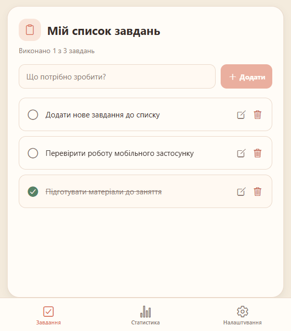
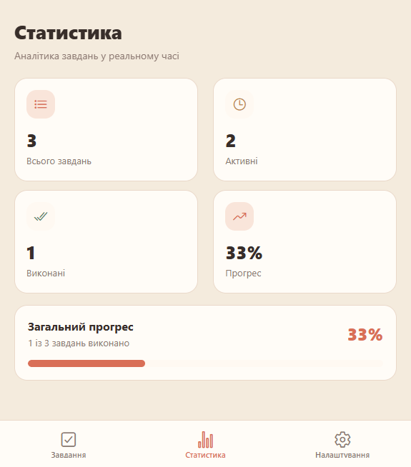
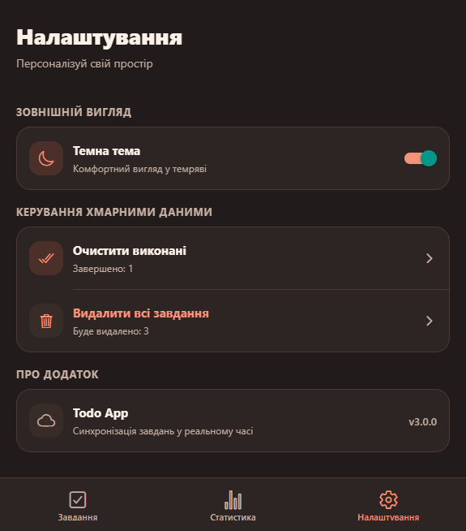

# Todo App 3.0 — Convex Cloud

Мобільний список завдань на React Native та Expo Router. Convex зберігає
завдання у хмарній базі даних і реактивно синхронізує зміни між вкладками та
відкритими клієнтами. Налаштування світлої/темної теми зберігається локально в
`AsyncStorage`.

## Налаштування Convex

Встанови залежності:

```bash
npm ci
```

Авторизуй Convex CLI, а тоді створи dev deployment і згенеруй типи:

```bash
npx convex login
npx convex dev
```

Під час першого запуску створи проєкт `rn-todo-list`. CLI створить `.env.local`
зі змінною `EXPO_PUBLIC_CONVEX_URL` та стежитиме за файлами в `convex/`.
Локальний `.env.local` не додавай у Git. Файл `.env.example` показує потрібний
формат змінної для ручного налаштування.

## Запуск

Залиш `npx convex dev` працювати в першому терміналі. У другому з кореня
проєкту запусти Expo:

```bash
npm start
```

Натисни `w` для вебверсії, `a` для Android Emulator або відскануй QR-код у
Expo Go. Якщо змінну Convex URL не налаштовано, застосунок покаже інструкцію
з підключення.

## Можливості

- Три вкладки: завдання, статистика та налаштування.
- Convex schema з індексами `by_created_at` і `by_completion`.
- Реактивні запити `getTodos` та `getStats`.
- Створення, редагування, перемикання статусу та видалення завдань через
  Convex mutations.
- Масове очищення виконаних завдань або всього списку.
- Світла/темна тема, збережена локально через `AsyncStorage`.
- Векторні іконки Ionicons і тематичний статус-бар та таб-навігація.

Перевірки:

```bash
npm run lint
npm run typecheck
```

## Скріншоти інтерфейсу

| Завдання — світла тема | Статистика — світла тема |
| --- | --- |
|  |  |

Налаштування у темній темі:


