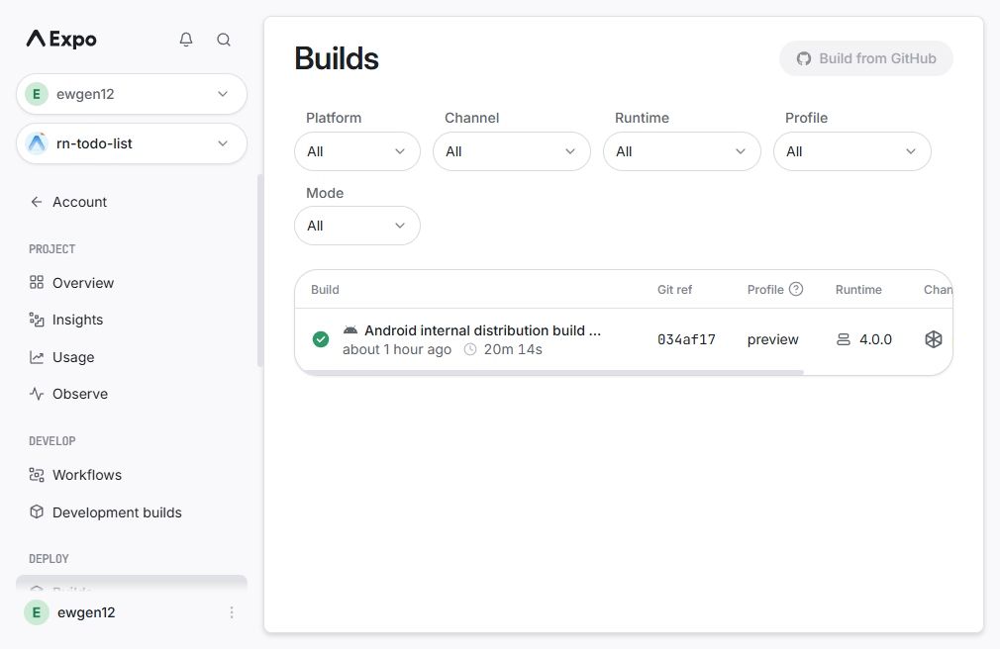

# Todo App 4.0 — EAS Build та OTA

React Native / Expo Todo App з Convex real-time backend, трьома EAS-середовищами,
окремими application ID, EAS Build профілями та EAS Update каналами.

EAS Build та EAS Update потребують Expo-акаунта і зв'язку проєкту з EAS.
Expo Dashboard: [@ewgen12/rn-todo-list](https://expo.dev/accounts/ewgen12/projects/rn-todo-list).

## Середовища

| APP_ENV | Назва | Android/iOS ID | Канал |
| --- | --- | --- | --- |
| `development` | Todo App Dev | `com.ewwwgg.rntodolist.dev` | `development` |
| `preview` | Todo App Preview | `com.ewwwgg.rntodolist.preview` | `preview` |
| `production` | Todo App | `com.ewwwgg.rntodolist` | `production` |

Ідентифікатор можна змінити через `APP_IDENTIFIER_PREFIX`. Динамічна
конфігурація та три профілі збірки описані у `app.config.ts` і `eas.json`.
Development та Preview використовують окремі іконки з бейджами.

## Підключення Expo та Convex

Встанови залежності та авторизуй CLI:

```bash
npm ci
npx eas-cli@latest login
npx eas-cli@latest project:init
npx convex login
npx convex dev --configure=new --dev-deployment=cloud
```

Під час `project:init` прив'яжи проєкт до свого Expo-акаунта. Команда
`npx convex dev --configure=new --dev-deployment=cloud` створить хмарний dev
deployment для проєкту `rn-todo-list`; окремо створи preview і production
deployments. У Expo/EAS створи середовища
`development`, `preview` та `production`. Для кожного середовища додай:

| Змінна | Development | Preview | Production |
| --- | --- | --- | --- |
| `APP_ENV` | `development` | `preview` | `production` |
| `EXPO_PUBLIC_CONVEX_URL` | Convex dev URL | same dev URL | Convex production URL |
| `CONVEX_DEPLOYMENT` | dev deployment | same dev deployment | production deployment |

`APP_ENV` уже налаштований для кожного EAS environment. Додай Convex URL та
deployment ID після створення хмарних Convex deployments. `project:init`
записав Expo owner і EAS project ID у конфігурацію. Не коміть `.env.local`:
файл `.env.example` містить лише шаблон. Після налаштування змінних запускай
`npx convex dev`; він генерує типи та
синхронізує backend. Для локальної розробки стягни EAS-змінні командою
`npx eas-cli@latest env:pull --environment development`. Перед store build
задеплой production Convex:

```bash
npx convex deploy
```

## Локальна розробка

Залиш `npx convex dev` працювати в першому терміналі. У другому запусти:

```bash
npx expo start
```

У `.env.local` встанови `APP_ENV=development`; для Expo Go натисни `w` або
відскануй QR-код.

## EAS Build

Development build з Dev Client:

```bash
npx eas-cli@latest build --platform android --profile development
```

Standalone Preview APK для внутрішнього тестування:

```bash
npx eas-cli@latest build --platform android --profile preview
```

Preview build успішно зібраний: [EAS Build 3244ed92](https://expo.dev/accounts/ewgen12/projects/rn-todo-list/builds/3244ed92-bb1a-46d4-97cd-9428d474e5d5).
Пряме посилання на APK: [Todo App Preview 4.0.0](https://expo.dev/artifacts/eas/I6mHcgByqmDZgg5bGHgaXLaE0iuPM6BcfRH0rTUn-qQ.apk).

Production builds:

```bash
npx eas-cli@latest build --platform all --profile production
```

Preview Android профіль налаштований на APK і internal distribution. Після
завершення завантаж збірку за посиланням EAS та встанови її на пристрій.

## OTA оновлення

Після встановлення Preview build зміни JS/UI-код і опублікуй update у той самий
канал:

```bash
npx eas-cli@latest update --platform all --environment preview --channel preview --message "UI update"
```

Опубліковане OTA-оновлення Preview: [EAS Update group](https://expo.dev/accounts/ewgen12/projects/rn-todo-list/updates/a2bd302e-2795-4a11-9a82-58f790ef7f93).

Закрий Preview App повністю та відкрий повторно, щоб перевірити OTA-оновлення.
Нативні зміни потребують нової збірки; JavaScript та assets можуть оновлюватися
OTA в межах сумісного `runtimeVersion`.

Профілі EAS прив'язують кожну збірку до власного `environment` та `channel`;
EAS Update має використовувати той самий канал і environment, що й встановлена
збірка.

## Перевірки та скріншоти інтерфейсу

```bash
npm run lint
npm run typecheck
```

| Завдання — світла тема | Статистика — світла тема |
| --- | --- |
|  |  |

Налаштування у темній темі:


Список EAS Build у Expo Dashboard:



Після встановлення Preview APK додай 1–2 скріншоти застосунку з фізичного
пристрою або емулятора.
